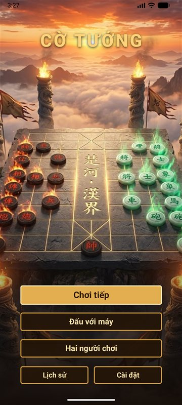
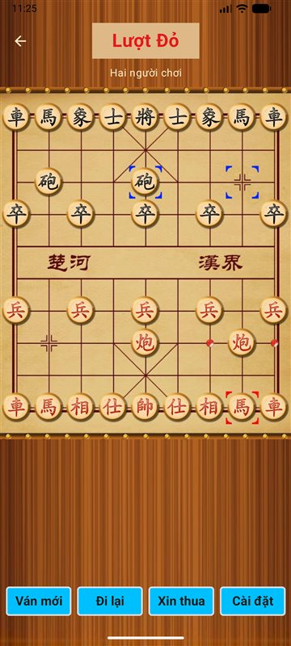
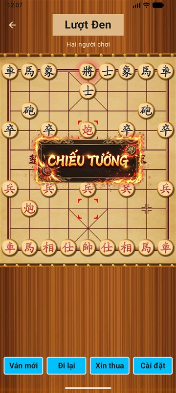
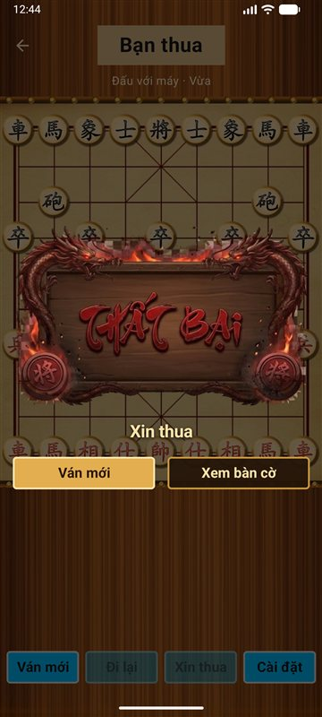
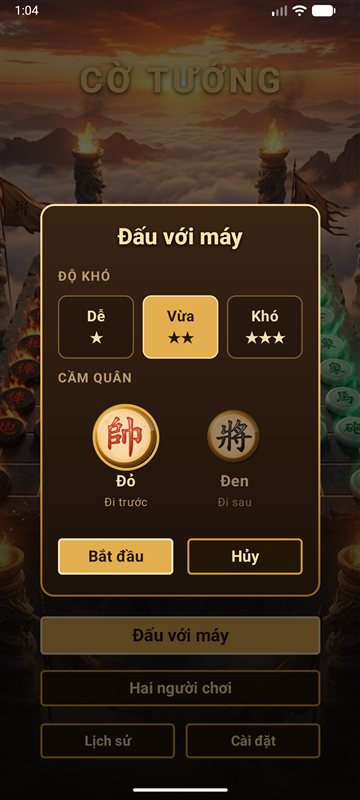
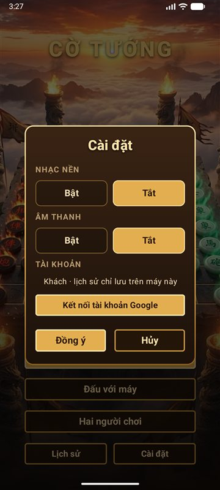

# Cờ Tướng: Kotlin · DDD · Clean Architecture · Firebase

Ứng dụng cờ tướng Android viết bằng **Kotlin** và **Jetpack Compose**. Có thể đánh với máy (3 mức độ) hoặc hai người chơi chung một máy. Ván đang chơi được lưu lại để chơi tiếp, lịch sử được sao lưu lên cloud, và app nhận được thông báo đẩy.

Mục tiêu của dự án là áp dụng **Domain-Driven Design** và **Clean Architecture** cho một bài toán có nhiều luật nghiệp vụ thật. Luật cờ được kiểm chứng bằng test, và Firebase được tích hợp ở tầng ngoài cùng mà không chạm vào domain.

| Màn hình chính | Chọn quân | Chiếu tướng |
|:---:|:---:|:---:|
|  |  |  |
| **Kết thúc ván** | **Chọn độ khó** | **Cài đặt & tài khoản** |
|  |  |  |

## Tính năng

**Chơi cờ**
- Luật cờ tướng đầy đủ: cản chân mã, chặn mắt tượng, pháo cần ngòi, tốt qua sông đi ngang, cửu cung, **lộ mặt tướng**.
- Phát hiện chiếu tướng, chiếu bí, hết nước đi (trong cờ tướng là thua), và hòa: lặp thế cờ 3 lần, 60 nước không ăn quân, cả hai bên hết quân tấn công.
- Đánh với máy 3 mức độ. Máy tính trên luồng nền nên giao diện không bị đơ, và dừng ngay khi người chơi đi lại.
- Đi lại, xin thua, ván mới. Mở app khi còn ván dở thì app hỏi chơi tiếp hay ván mới.
- Biển thông báo động khi chiếu tướng, thắng, thua, hòa. Có âm thanh chọn quân, đi quân và nhạc nền.

**Dữ liệu và cloud**
- Mọi nước đi được lưu ngay vào máy (Room), nên chơi offline được.
- Ván đã kết thúc được sao lưu lên Firestore, gắn với tài khoản khách tự tạo (người dùng không phải đăng nhập).
- **Kết nối tài khoản Google**: tài khoản khách được nâng cấp và giữ nguyên dữ liệu. Cài lại app hoặc đổi máy thì lịch sử được khôi phục.
- Nhận thông báo đẩy (FCM). Bấm vào thông báo có thể mở thẳng ván đang dở.

## Kiến trúc

Phụ thuộc chỉ hướng **từ ngoài vào trong**. Tầng trong không biết tầng ngoài dùng công nghệ gì.

```
┌───────────────────────────────────────────────────────────────────┐
│ 1. Frameworks & Drivers   Compose · Room · Firebase · Android     │
│  ┌─────────────────────────────────────────────────────────────┐  │
│  │ 2. Interface Adapters                                       │  │
│  │    ViewModel · RoomGameRepository · FirestoreCloudGameStore │  │
│  │    FirebaseAccountService · AlphaBetaComputerPlayer         │  │
│  │  ┌───────────────────────────────────────────────────────┐  │  │
│  │  │ 3. Application (Use Cases)                            │  │  │
│  │  │    StartNewGame · PlayMove · PlayComputerMove · Undo  │  │  │
│  │  │    Resign · GetHistory · SyncCloudGames · SignIn ...  │  │  │
│  │  │  ┌─────────────────────────────────────────────────┐  │  │  │
│  │  │  │ 4. Domain                                       │  │  │  │
│  │  │  │    Game (aggregate) · luật cờ · domain event    │  │  │  │
│  │  │  └─────────────────────────────────────────────────┘  │  │  │
│  │  └───────────────────────────────────────────────────────┘  │  │
│  └─────────────────────────────────────────────────────────────┘  │
└───────────────────────────────────────────────────────────────────┘
```

| Module | Tầng | Phụ thuộc | Nội dung |
|---|---|---|---|
| `:domain` | 4 | không gì cả | Kotlin thuần: model, luật cờ, domain event, interface `GameRepository` và `ComputerPlayer` |
| `:application` | 3 | `:domain` | Use case, DTO, port `AccountService` và `CloudGameStore` |
| `:infrastructure:ai` | 2 | `:domain` | `AlphaBetaComputerPlayer` cài đặt port `ComputerPlayer` |
| `:infrastructure:persistence` | 2 + 1 | `:domain`, Room | `RoomGameRepository` cài đặt `GameRepository` |
| `:infrastructure:firebase` | 2 + 1 | `:application`, Firebase | Auth, Firestore, FCM, Crashlytics, Performance |
| `:app` | 2 + 1 | tất cả | Compose UI, ViewModel (MVVM), `AppContainer` (composition root) |

Ranh giới được Gradle ép buộc: `:domain` và `:application` là module Kotlin/JVM thuần, nên không thể import nhầm class Android, Room hay Firebase vào đó.

### Domain

| Khái niệm DDD | Trong code |
|---|---|
| Aggregate root | `Game`: chỉ đổi trạng thái qua `play()`, `undoLastMove()`, `resign()`, nên không bao giờ rơi vào trạng thái sai luật |
| Value object | `Square`, `Move`, `Piece`, `Board` (bất biến), `Position`, `Participants`, `GameId` |
| Domain service | `MoveGenerator`, `CheckDetector`, `GameArbiter` (trọng tài quyết định thắng, thua, hòa) |
| Domain event | `MovePlayed`, `GeneralInCheck`, `GameFinished`, `MoveUndone` |
| Repository / Port | `GameRepository`, `ComputerPlayer`: domain định nghĩa interface, tầng ngoài cài đặt |

### Use case không phải chỉ một dòng gọi repository

Mỗi use case chứa kịch bản nghiệp vụ của ứng dụng, còn luật cờ nằm trong domain:

- **StartNewGame**: chỉ cho phép một ván dở. Ván đang chơi bị xử thua cho bên bỏ cuộc trước khi tạo ván mới.
- **PlayComputerMove**: máy có thể nghĩ vài giây. Trước khi lưu, use case kiểm tra ván không bị thay đổi trong lúc đó (optimistic concurrency).
- **UndoMove**: khi đánh với máy thì lùi về lượt gần nhất của người (thường là 2 nước); khi 2 người chơi thì lùi 1 nước.
- **SyncCloudGames**: hợp nhất lịch sử giữa máy và cloud. Ván chỉ có trong máy thì tải lên, ván chỉ có trên cloud thì khôi phục về. Không xóa gì, nên chạy bao nhiêu lần cũng an toàn.
- **SignOut**: đẩy nốt các ván chưa sao lưu lên cloud rồi mới đăng xuất, để không mất lịch sử.

### MVVM ở tầng giao diện

- View (Compose) chỉ hiển thị `StateFlow` của ViewModel và báo lại thao tác. Luồng dữ liệu một chiều.
- ViewModel gọi use case, không cầm aggregate `Game` mà chỉ nhận bản chụp chỉ-đọc `GameState`.
- Sự kiện chỉ xảy ra một lần (chiếu tướng, mở ván mới) đi qua `Channel`.
- Âm thanh và cài đặt đi qua interface (`GameSounds`, `AudioSettings`), nên ViewModel test được trên JVM.

### Offline-first và các decorator

Room là kho dữ liệu chính. Các tính năng cloud được thêm bằng **decorator** ở composition root, không sửa code cũ:

```kotlin
// AppContainer.kt
val repository = CloudBackupGameRepository(RoomGameRepository.create(context))       // sao lưu ván đã xong lên Firestore
val computerPlayer = PerformanceTracedComputerPlayer(AlphaBetaComputerPlayer())       // đo thời gian AI nghĩ
```

Chỉ lưu **danh sách nước đi**, cả trong Room lẫn Firestore. Khi tải, `Game.restore()` đi lại từng nước từ đầu, nên dữ liệu hỏng bị phát hiện ngay.

## Firebase

| Dịch vụ | Dùng để làm gì |
|---|---|
| **Cloud Messaging** | Nhận thông báo đẩy, có kênh thông báo riêng, xin quyền thông báo trên Android 13+. Dữ liệu `action=resume_game` trong thông báo mở thẳng ván đang dở. Mọi máy đăng ký topic `all_players`. |
| **Authentication** | Tài khoản khách ẩn danh tự tạo. Kết nối Google qua **Credential Manager**: tài khoản khách được *link* sang Google, giữ nguyên uid. Nếu tài khoản Google đã có dữ liệu ở máy khác thì chuyển sang tài khoản đó và khôi phục lịch sử. |
| **Firestore** | `users/{uid}` (hồ sơ), `users/{uid}/games` (ván đã kết thúc), `users/{uid}/devices` (token FCM). Security Rules ([firestore.rules](firestore.rules)): mỗi người chỉ đọc và ghi được dữ liệu của chính mình. |
| **Crashlytics** | Tự gửi báo cáo khi app crash, kèm phiên bản app. |
| **Performance** | Trace `ai_choose_move` đo thời gian máy nghĩ theo từng độ khó, kể cả khi bị hủy giữa chừng. |

## AI

Engine nằm trong `:infrastructure:ai`, dùng biểu diễn riêng để tối ưu tốc độ (`IntArray` 90 ô, đi và lùi nước tại chỗ thay vì tạo object mới):

- Negamax alpha-beta với **PVS** và **tìm sâu dần** (iterative deepening) có giới hạn thời gian.
- **Bảng băm vị trí** (transposition table) với khóa **Zobrist** cập nhật tăng dần.
- Sắp xếp nước đi: nước từ bảng băm, ăn quân theo MVV-LVA, killer move, history heuristic.
- **Quiescence search** để tránh đánh giá sai giữa chuỗi đổi quân, và gia hạn độ sâu khi bị chiếu.
- Chạy trên `Dispatchers.Default` và dừng ngay khi coroutine bị hủy.

| Mức | Độ sâu đạt được | Thời gian tối đa | Ghi chú |
|---|---|---|---|
| Dễ | 2 | 0,5 s | Chọn ngẫu nhiên trong các nước gần tốt nhất |
| Vừa | 4 | 1,5 s | Thường xong trong dưới 0,1 s |
| Khó | 7 ở khai cuộc và trung cuộc, 11 ở tàn cuộc | 3 s | Tìm sâu dần tới khi hết giờ (trần 32 chỉ là giới hạn vòng lặp); dừng sớm khi thấy chiếu bí |

Độ sâu đo trên PC. Điện thoại thường chậm hơn PC nên mức Khó có thể đạt độ sâu thấp hơn trong cùng 3 giây.

## Kiểm thử

**59 unit test**, chạy bằng `./gradlew test :app:testDebugUnitTest`:

| Phần | Số test | Nội dung chính |
|---|---|---|
| Domain | 21 | **Perft** so với giá trị chuẩn 44 / 1.920 / 79.666; luật từng quân; chiếu bí, hết nước, các kiểu hòa, đi lại, xin thua |
| Use case | 16 | Chạy với repository giả trong bộ nhớ: lượt người và máy, đi lại trong lúc máy nghĩ, lịch sử, đồng bộ cloud, đăng nhập và đăng xuất |
| AI | 10 | Perft độ sâu 4 (3.290.240 thế cờ); luật đi khớp với domain qua 40 ván ngẫu nhiên; tìm chiếu bí, giới hạn thời gian, dừng khi bị hủy |
| Lưu trữ | 1 | Ván cờ đi qua bảng Room rồi dựng lại vẫn giữ nguyên |
| ViewModel | 11 | Chọn quân và đi quân, máy đáp lại, hủy máy khi đi lại, hỏi xác nhận ván mới, lời hỏi chơi tiếp khi mở app, cài đặt |

## Công nghệ

Kotlin 2.4 · Jetpack Compose (Material 3, Canvas, animation) · MVVM với ViewModel + StateFlow · Coroutines · Room · Navigation Compose · Firebase (FCM, Auth, Firestore, Crashlytics, Performance) · Credential Manager · Gradle Kotlin DSL + version catalog · JUnit 5 / JUnit 4 · R8 (APK release 7,6 MB)

## Chạy dự án

Yêu cầu Android Studio bản mới (JDK 17 trở lên, Android SDK 37).

```bash
./gradlew test :app:testDebugUnitTest   # chạy toàn bộ unit test
./gradlew :app:installDebug             # cài lên máy ảo hoặc điện thoại đang kết nối
```

App cần một project Firebase để build:

1. Tạo project trên [Firebase Console](https://console.firebase.google.com), thêm app Android với package `com.quangthanh.xiangqi`.
2. Tải `google-services.json` về đặt vào thư mục `app/` (file này không có trong repo).
3. Bật **Authentication** (Anonymous và Google), tạo **Firestore** rồi dán nội dung [firestore.rules](firestore.rules) vào tab Rules.
4. Để dùng đăng nhập Google, thêm SHA-1 của khóa ký (xem bằng `./gradlew :app:signingReport`) vào Project settings.

## Hạn chế đã biết

- Luật hòa đơn giản hóa: lặp thế cờ 3 lần thì tính hòa. Luật thi đấu thật xử thua bên chiếu dai, đuổi dai.
- Tài khoản khách gắn với lần cài app. Chưa kết nối Google mà gỡ app thì mất lịch sử.
- Thông báo đẩy hiện gửi từ Firebase Console. Chưa có server tự gửi thông báo cho từng người.

## Giấy phép

[MIT](LICENSE) © 2026 Võ Quang Thành
